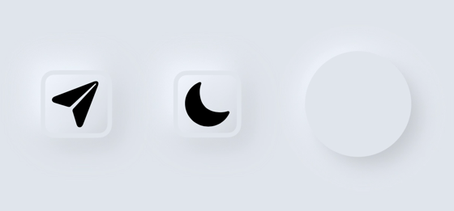
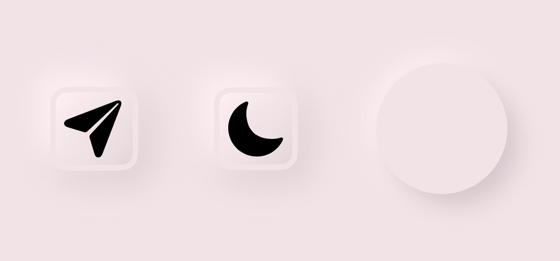
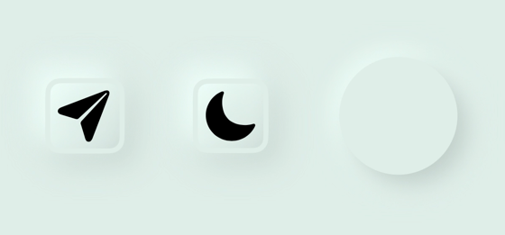
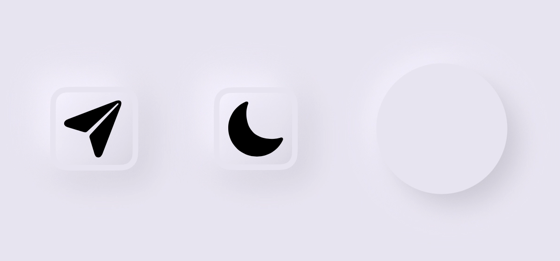

# NeumorphicSwiftUI

[](https://github.com/A-bv/NeumorphicSwiftUI/actions/workflows/ci.yml)


[](LICENSE)

<table>
  <tr>
    <td width="50%"></td>
    <td width="50%"></td>
  </tr>
  <tr>
    <td width="50%"></td>
    <td width="50%"></td>
  </tr>
</table>

*Press the button, hold the switch. The same controls in light and dark, shown in four of the palettes you can give it.*

Soft, tactile controls for SwiftUI: buttons and toggles that look gently pressed into
the screen or lifted out of it. It's the calm, modern *neumorphic* look, and you add it
to your own app in one line, in your own colors.

Dream up something beautiful: a hushed music player, a cozy smart-home panel, a
calculator that begs to be tapped. Wherever a soft, physical feel would make your app
more inviting, this gives you the pieces.

## Features
- **Button and toggle styles**, plus a shadow you can add to any view.
- **One-color theming.** One surface color builds the whole palette, and you can override any color by hand.
- **Adjustable shape.** Corner radius, shadow softness, and depth, not only color.
- **No dependencies, no setup.** It layers on top of your existing views.

## Add it to your app

**In Xcode**
1. Open **File ▸ Add Package Dependencies…**
2. Paste `https://github.com/A-bv/NeumorphicSwiftUI` into the search box (top right).
3. Leave the rule on **Up to Next Major Version**, then **Add Package** to your app.

**Or in `Package.swift`**
```swift
.package(url: "https://github.com/A-bv/NeumorphicSwiftUI", from: "3.3.0")
```

## Use it
Pick one color near the top of your app:
```swift
ContentView()
    .neumorphicTheme(NeumorphicPalette(surface: .myGray))
```
Then style anything inside it:
```swift
Button("Send") {}.buttonStyle(NeumorphicButtonStyle())
Toggle("Dark", isOn: $isOn).toggleStyle(NeumorphicToggleStyle())
Circle().fill(.myGray).neumorphicShadow()
```
Want to hand-pick every color instead? The palette takes them all.

Want it rounder, softer, or more raised? Pass metrics alongside the palette:
```swift
ContentView()
    .neumorphicTheme(
        NeumorphicPalette(surface: .myGray),
        metrics: NeumorphicMetrics(cornerRadius: 20, depth: 6))
```

See every style in code: [`Examples/DemoApp`](Examples/DemoApp).

## Contributing
Open the package in **Xcode 16 or newer** and you're ready. That's all the tests need.

## License
MIT. Use it freely, just keep the notice. See [LICENSE](LICENSE).
